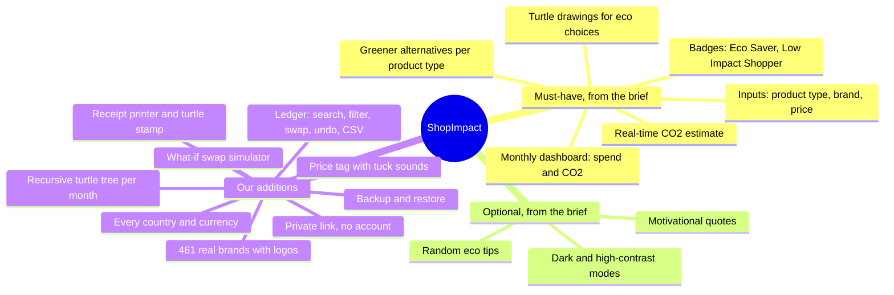

# ShopImpact — design document

*Stage 1 (understand the problem & plan the design), Stage 2 (Python logic) and Stage 3 (Streamlit interface) of the WACP brief, Scenario 1.*

---

## 1. The problem

Every purchase has a hidden environmental cost, but shoppers never see it. A receipt shows the price, not the carbon. People who would happily choose a lighter option don't know which purchases matter, by how much, or what to buy instead.

**ShopImpact's job:** show the CO₂ cost of a purchase *at the moment it's logged*, suggest a lighter alternative straight away, and make building better habits feel rewarding rather than guilt-inducing.

## 2. Who it's for

The brief names three groups: young adults, students, and eco-conscious families curious about their footprint. The personas below are illustrative. They were written to test design decisions against, not drawn from interviews.

| | **Student** (19, first year at university) | **Young professional** (26, first job, shops online) | **Parent** (38, buys for a family of four) |
|---|---|---|---|
| Situation | Tight budget; buys clothes, food, a phone upgrade | Lots of delivery, fast fashion, weekend flights | Big weekly shop, school clothes, toys |
| Pain point | "I don't know which of my purchases actually matter." | "Going green feels like giving everything up." | "No time to research every brand." |
| Needs | Fast logging, instant feedback, no jargon | Concrete swaps that still feel like treats | Brand suggestions, a monthly overview |
| Device | Phone first | Laptop and phone | Laptop on Sunday evening |
| Success looks like | Notices beef and fast fashion dominate their month | Swaps two flights for trains and sees the saving | Stays under a family budget and earns a badge |

### Feelings we want to create

| Feeling | How the design creates it |
|---|---|
| **Awareness** | Every purchase prints a receipt with its CO₂ line and the formula behind it (`£85.00 × 1.20 kg/£`). "Feels like" converts kg into km driven and phone charges. |
| **Empowerment** | Every high-impact estimate comes with a one-tap greener swap and the saving in kg and %. The what-if slider shows what changing habits would do. |
| **Fun, not guilt** | Turtle drawings, badges, tuck sounds and a growing tree. Copy is plain and kind: "a heavier footprint", never "bad". Fern/ochre/clay colours inform rather than alarm. |
| **Trust** | Estimates are labelled as approximate. The method is explained in Settings. Data stays anonymous (no account, no email). |

## 3. Features: must-have and nice-to-have



| Priority | Feature | Status |
|---|---|---|
| Must | Product type, brand, price inputs | Done — 77 types, 461 brands (plus free text), price box + price tag |
| Must | Real-time CO₂ calculation | Done — recalculated on every change |
| Must | Monthly dashboard of spend and CO₂ | Done — metric cards, budget ring, Altair month curve |
| Must | Fun badges | Done — 10 badges with fair, documented rules |
| Must | Greener alternatives per product type | Done — swap + greener brands for every type |
| Must | Turtle graphics on eco choices | Done — sprig / footprints / rosettes / tree |
| Nice | Random eco tips | Done — on every receipt and a "Did you know" card |
| Nice | Dark / high-contrast mode | Done — three themes and a large-text option |
| Nice | Motivational quotes | Done — Garden view |
| Extra | Sounds, what-if, brands with logos, currencies, backup | Done |

## 4. Wireframes

The brief asks for rough wireframes on paper or in a tool like Canva. These text wireframes record the layout that was built. **Add a photo of your hand-drawn sketch to `docs/wireframes/` and link it here.**

### Overview (desktop)

The brief's layout: inputs at the top, dashboard in the centre, badges and turtle drawings on the side.

```
┌──────┬─────────────────────────────────────────────────────┬──────────────────────┐
│ ◉    │ OVERVIEW · NOVEMBER 2026                ‹ November › │                      │
│ Shop │ Good evening                                         │ ┌──────────────────┐ │
│Impact│ ┌─ THE TILL (moss green) ─────────────────────────┐  │ │ ● RECEIPT  ▁▁▁▁▁ │ │
│      │ │ [Product type ▾] [Brand ▾ logo] [Price] [Date]  │  │ ├──────────────────┤ │
│ ▣    │ │ [Item (optional)] [====🏷====== price tag] [RING]│  │ │ ShopImpact       │ │
│Overvw│ │ 102.00 kg CO₂e  HIGH  ≈600 km   [Try recycled…] │  │ │ Leather shoes    │ │
│ ▤    │ └─────────────────────────────────────────────────┘  │ │ CO₂e ... 102 kg  │ │
│Ledger│ ┌Footprint ◔┐ ┌Spent ━━┐ ┌Eco score B┐ ┌Feels like┐   │ │   [turtle stamp] │ │
│ ⇄    │ └───────────┘ └────────┘ └───────────┘ └──────────┘   │ │ TIP · …          │ │
│Swaps │ ┌ Footprint over the month ─────────────────────────┐ │ └/\/\/\/\/\/\/\/\/─┘ │
│ ✪    │ │  ╱‾‾‾‾╲___╱‾‾  - - - budget - - -   ⋯ projected   │ │ ┌ Did you know ────┐ │
│Badges│ └───────────────────────────────────────────────────┘ │ └──────────────────┘ │
│ ♣    │ ┌ Where it comes from ─┐ ┌ Latest purchases ─────────┐│ ┌ Badge shelf ─────┐ │
│Garden│ │ ▓▓▓▓▓ Food 43%       │ │ ● Weekly pass   2.0 kg    ││ │ ✪ ✪ ✪ ✪ ✪        │ │
│ ⚙    │ │ ▓▓▓ Electronics 29%  │ │ ● Tofu & lentils 1.4 kg   ││ │ Next up: …       │ │
└──────┴─────────────────────────────────────────────────────┴──────────────────────┘
```

### Phone

```
┌───────────────────────┐
│ Good evening          │
│ ‹ November 2026 ›     │
│ ┌ THE TILL ─────────┐ │
│ │ [Product type ▾]  │ │
│ │ [Brand ▾]         │ │
│ │ [Price]           │ │
│ │ [==🏷== price tag]│ │
│ │ [Date] [Item]     │ │
│ │ [ RING IT UP ]    │ │
│ └───────────────────┘ │
│ ┌ Receipt ──────────┐ │
│ ┌ Footprint ┐┌Spent┐  │
│ …                     │
├───────────────────────┤
│ ▣  ▤  ⇄  ✪  ♣  ⚙     │  ← bottom tab bar
└───────────────────────┘
```

### Other screens

```
LEDGER                                   SWAPS
[Search…] (Low)(Med)(High) [Sort▾] [CSV] ┌ What if you swapped? ──┐ ┌ Biggest wins ┐
Showing 16 · Spend £481 · 200.7 kg       │ [====●=====] 50%       │ │ Beef → Plant │
┌───────────────────────────────────┐    │ Save 69.9 │ Total │ 77 │ │ [Swap]       │
│24 Tue  👞 Leather shoes  Clarks  £85│    └────────────────────────┘ └──────────────┘
│        102 kg ▮▮▮▮  HIGH  [Swap] 🗑 │    ┌ Greener brands & shops (logo wall) ────┐
│23 Mon  🚌 Weekly pass    SMRT    £25│    └────────────────────────────────────────┘
└───────────────────────────────────┘    (All)(Clothing)(Food)… → catalogue cards

BADGES (grid of 10)                      GARDEN
┌──────────┐ ┌──────────┐                ┌ This month's tree ─────┐ ┌ How it grows ┐
│ rosette  │ │ rosette  │                │      🌳 (turtle)        │ │ key + stats  │
│ Name EARN│ │ Name ON  │                │  ___________________   │ ├ 6-month bars ┤
│ ▮▮▮▮▮▮▯▯ │ │ TRACK    │                └────────────────────────┘ └──────────────┘
│ [Watch]  │ │ [Watch]  │                ┌ “Buy less, choose well…” ─────────────┐
└──────────┘ └──────────┘                └───────────────────────────────────────┘
```

## 5. Visual design

### Palette

Earth tones, as the brief suggests (greens, blues, browns), with one rule: **fern, ochre and clay only ever mean an impact tier**, so colour always carries information.

| Token | Hex (Daylight) | Role |
|---|---|---|
| Lichen | `#DCE4D2` | App background |
| Paper | `#F7F6EF` | Cards, receipts |
| Moss ink | `#1E3B2F` | Text, the till counter |
| Glacier | `#2F6F8F` | Data and accents (month curve) |
| Fern | `#356C3D` | Low impact, positive states |
| Ochre | `#7E590D` | Medium impact |
| Clay | `#B04E34` | High impact (used sparingly) |

Night canopy (dark) and High contrast (black, white and yellow) reuse the same roles with different values.

### Accessibility checks (WCAG 2.1 AA needs 4.5 : 1 for normal text)

| Text | Contrast | Result |
|---|---|---|
| Body text — ink on paper | 11.3 : 1 | Pass |
| Secondary text | 6.2 : 1 | Pass |
| Hints and axis labels | 4.8 : 1 | Pass |
| Low-tier pill on its tint | 4.9 : 1 | Pass |
| Medium-tier pill on its tint | 5.1 : 1 | Pass |
| High-tier text on paper | 4.9 : 1 | Pass |
| Till labels on moss | 6.9 : 1 | Pass |
| Till placeholder text | 4.5 : 1 | Pass |
| Night canopy hints | 6.1 : 1 | Pass |

Other accessibility decisions:
- A large-text option.
- A reduce-motion switch that also follows the operating-system setting.
- Every action is a real button with a label.
- The colour of an impact tier is always paired with a word ("low", "high").

### Type

| Role | Typeface | Why |
|---|---|---|
| Headings and big numbers | Bricolage Grotesque | Friendly and characterful, with large, readable figures |
| Body | Figtree | Open shapes; easy to read at the brief's "large fonts" |
| Receipts and figures | Martian Mono | Feels like a till roll; tabular numbers line up |

### Signature element: the till and receipt printer

Ringing up a purchase feeds a receipt out of a little printer, line by line, with a soft printer sound. A Python turtle then draws a stamp on it:
- a **leaf sprig** for a light buy;
- **light footprints** for a medium buy;
- a **deep footprint** for a heavy buy.

This turns the brief's "Turtle graphics when users make eco-friendly choices" into the moment of feedback itself.

### Motion and sound

- **Motion:** used where it explains something (the receipt feeding out, the turtle drawing, bars growing). It's switched off by *Reduce motion*.
- **Sounds:** synthesised in the browser, so there are no audio files:
  - a chime that is brighter for lighter purchases;
  - printer chatter;
  - a pen scratch while the turtle draws;
  - a "tuck" at every step of a slider;
  - a fanfare for badges.
- Sound can be muted, and the volume adjusted.

## 6. Logic design (Stage 2)

### Data structures

| What | Python structure | Where |
|---|---|---|
| A purchase | `dict` — product type, brand, price, currency, date, frozen `price_gbp` and `co2`, exchange `rate`, note, `swapped_from` | `engine.py`, `store.py` |
| Purchase history | `list` of purchase dicts, oldest first | `store.purchases()` |
| Product catalogue | `dict` of dicts: name, group, multiplier, swap target, reason, ideas, tags | `catalog.py` |
| Brands | `list` of tuples → dicts, plus a name → brand lookup `dict` | `brands.py` |
| Countries and currencies | `list` of country dicts; `dict` of currency → rate | `world.py`, `catalog.py` |
| Badges | `list` of dicts, each holding a `rule` function | `badges.py` |
| Monthly dashboard | one summary `dict` built from the month's list | `engine.monthly_summary()` |

### Calculations

```
CO₂ of a purchase   = price in £ × product multiplier (kg CO₂e per £)   — frozen at entry
monthly footprint   = sum of the month's purchases
eco score (0–100)   = 100 × (1 − min(kg per £ ÷ 1.2, 1)),
                      × budget ÷ footprint when the month is over budget
impact tier         = low ≤ 0.30 kg/£ < medium ≤ 0.80 kg/£ < high
swap saving         = price in £ × (multiplier − greener multiplier)
```

Months are found from ISO dates (`YYYY-MM-DD`). Python's `calendar` module gives the days in each month for the day-by-day running total. "Today" comes from the shopper's own time zone.

### Badge rules

| Badge | Earned when | Notes |
|---|---|---|
| First Step | You log your first purchase | Lifetime badge |
| Eco Saver of the Month | 5+ purchases and under the CO₂ budget **when the month ends** | "On track" during the month |
| Low Impact Shopper | 5+ purchases averaging ≤ 0.30 kg/£ | Same line as the low tier |
| Second-Life Hero | 3 second-hand, refurbished, rented or repaired buys | |
| Ethical Brand Ally | 2 purchases from greener brands | |
| Green Streak | Your last 5 logged purchases were all low impact | |
| Plant Powered | 3 plant-based or local food shops | |
| Mindful Spender | 5+ purchases and within the spending budget **when the month ends** | "On track" during the month |
| Swap Master | 3 purchases swapped for the greener option | |
| Carbon Cutter | 20% below last month, **compared day for day** | Locks in at month end |

Only purchases worth about £1 or more count towards badges.

### Suggestions

Every product type stores a `swap_to` target and a one-line reason. Greener brands for each type come from the brand list, followed by general ideas such as "a cobbler resole". The swap is offered in the till before you buy, and in the ledger afterwards.

### Modules

Each module does one job (see the README's project structure). All the rules live in `shopimpact/service.py`, so the Streamlit app and the optional web edition can never disagree.

## 7. Interface design (Stage 3)

| Brief guidance | How ShopImpact follows it |
|---|---|
| Inputs at the top | The till sits at the top of the Overview |
| Dashboard in the centre | Metric cards, the month curve and the breakdowns are in the main column |
| Badges and Turtle on the side | The receipt with its turtle stamp and the badge shelf sit in the right column |
| Buttons, sliders, checkboxes | `st.button`, `st.slider` and `st.select_slider` (the price tag), `st.toggle`, `st.pills`, `st.segmented_control` |
| Visual hierarchy | Big display numbers for the key figures, small grey labels, generous spacing |
| Earthy palette, large fonts | See section 5 |
| Real-time updates | Every widget change reruns the script and recalculates in Python |

## 8. Decisions and trade-offs

- **Turtle on the web:** Python's `turtle` needs a desktop window, which Streamlit Cloud doesn't have. `SvgTurtle` implements the same commands and records the moves so the page can replay them. The same drawing functions also run unchanged on a real `turtle.Turtle()` (`python -m shopimpact.turtle_window`).
- **Spend-based estimates:** multiplying price by a factor is simple and transparent, but it's an approximation. A pricier item counts as more carbon, and factors are calibrated in pounds. The app says the figures are for comparing choices, not a carbon audit.
- **Frozen values:** each purchase keeps the £ value, CO₂ and exchange rate it had when logged, and each month keeps its budget. History never changes behind the user's back.
- **No accounts:** an anonymous private link (remembered by the browser) keeps the app simple and private. Backup and restore protect against Streamlit Cloud resetting its storage.

## 9. Ethics

- Estimates are approximate and labelled as such, with the method in Settings and the formula on every receipt.
- No personal data is collected. There is no sign-up; the only identifier is a random id.
- Suggestions favour second-hand, refurbished, refill and repair over simply buying more.
- Brand logos are used only to identify brands and remain their owners' trademarks.
